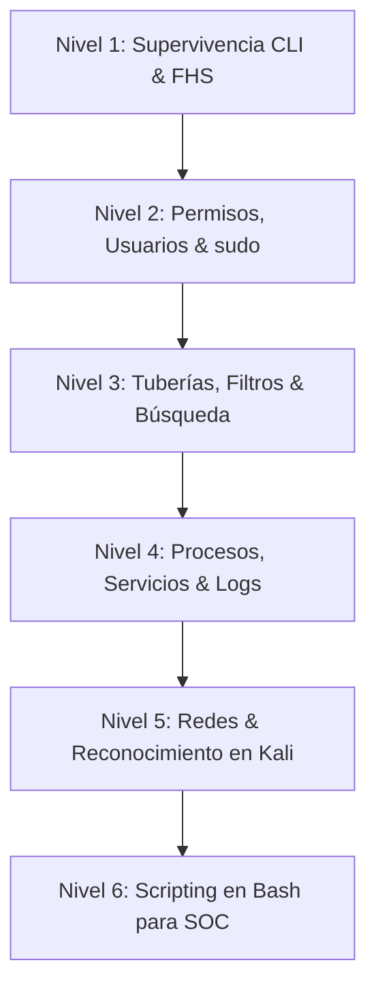

<!-- [Agent-Architect] 2026-11-09: Creación del índice y hoja de ruta del módulo de Linux y Kali CLI para Phase 1 Foundations. Basado en el método de entrenamiento progresivo del Maestro Experto en Kali Linux. -->

# Linux & Kali CLI Mastery 🐧🛡️

> **Módulo:** Phase 1 — Foundations  
> **Instructor:** Maestro Experto en Kali Linux y Administración de Sistemas (CLI)  
> **Metodología:** *Explicación Breve (máx 4 líneas) -> Ejemplo Real -> Prueba Práctica (Laboratorio)*  
> **Objetivo:** Dominar la línea de comandos de Linux desde la navegación básica hasta el diagnóstico de red, análisis forense de logs y scripting de automatización para operaciones de seguridad (SOC / Blue Team).

---

## 🎯 Reglas de Entrenamiento del Módulo

1. **Cero teoría extensa:** Las explicaciones conceptuales van directo al grano técnico (máximo 4 líneas por concepto) y saltan de inmediato a la terminal.
2. **Estructura estandarizada de cada lección:**
   - **Concepto:** Qué se hace y por qué importa en un entorno real de TI o Ciberseguridad.
   - **Demostración:** El comando exacto con el desglose pormenorizado de sus banderas (*flags*) y el ejemplo de salida esperada.
   - **Prueba de Laboratorio (Reto):** Misión concreta a ejecutar en la propia terminal de Kali Linux.
3. **Validación rigurosa de salidas:** Cada prueba exige contrastar la salida cruda de la terminal o responder la pregunta de verificación antes de avanzar a la siguiente lección.
4. **Principio de menor privilegio:** Uso prioritario de usuarios estándar y llamada a `sudo` únicamente cuando sea estrictamente indispensable, fomentando el uso de ayudas nativas (`man`, `--help`).

---

## 🧭 Plan de Entrenamiento Progresivo (6 Niveles)

### Detalle de Niveles y Habilidades:

| Nivel | Temas Clave | Comandos Principales | Estado |
|---|---|---|---|
| **Nivel 1: Supervivencia en CLI & FHS** | Identidad, arquitectura del kernel, rutas relativas/absolutas, jerarquía FHS (`/etc`, `/var`, `/proc`, `/tmp`), manipulación segura de archivos. | `whoami`, `id`, `pwd`, `uname`, `ls -la`, `cd`, `mkdir`, `cp -p`, `mv`, `rm -i`, `cat`, `less`, `file` | 🟡 En curso |
| **Nivel 2: Permisos & Menor Privilegio** | Permisos octales y simbólicos, propietarios, grupos, sticky bit, elevación legítima con `sudo` y auditoría de `sudoers`. | `chmod`, `chown`, `chgrp`, `umask`, `sudo -l`, `/etc/sudoers`, `visudo` | ⚪ Planificado |
| **Nivel 3: Tuberías, Filtros & Búsqueda** | Redirecciones (`>`, `>>`, `2>&1`, `/dev/null`), pipelines, filtrado forense de texto y búsqueda profunda en el sistema de archivos. | `\|`, `tee`, `grep`, `egrep`, `cut`, `awk`, `sed`, `sort`, `uniq -c`, `wc`, `find`, `locate` | ⚪ Planificado |
| **Nivel 4: Procesos, Servicios & Logs** | Gestión de procesos, prioridades, señales de terminación, administración de servicios systemd y auditoría de logs del sistema. | `ps aux`, `top`, `htop`, `pgrep`, `kill`, `pkill`, `systemctl`, `journalctl`, `/var/log/auth.log` | ⚪ Planificado |
| **Nivel 5: Diagnóstico de Red & Kali Recon** | Interfaces de red, tablas de enrutamiento, sockets abiertos, pruebas de conectividad, resolución DNS, escaneo y captura de paquetes. | `ip`, `ss`, `netstat`, `ping`, `traceroute`, `dig`, `curl`, `nmap`, `nc`, `tcpdump` | ⚪ Planificado |
| **Nivel 6: Automatización con Bash** | Variables, condicionales, bucles, manejo de argumentos, parseo automático de logs y scripts defensivos para triaje en el laboratorio. | `bash`, `shebang`, `if/else`, `for/while`, `case`, `$1..$n`, `$?`, scripts de auditoría | ⚪ Planificado |

---

## 🧪 Índice de Laboratorios Prácticos

- **[Lab 1.1 & 1.2 — Supervivencia en CLI, Identidad y Anatomía del FHS](./01_survival_and_identity.md)** *(🟡 En progreso)*
  - Identidad, kernel e interfaces de red (`whoami`, `id`, `uname -srm`, `ip -br a`, `tee`).
  - Anatomía de directorios críticos para el Blue Team (`/etc/passwd`, `/etc/shadow`, `/var/log`, `/proc`, `/tmp`).
  - Prácticas de verificación y evidencias técnicas.

---

*Phase 1: Foundations — CyberMind Security Operations*
