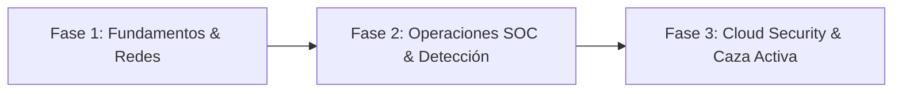

<!-- [Agent-Architect] 2026-10-22: Creación de la hoja de ruta estratégica y metodología de aceleración profesional hacia roles remotos en Ciberseguridad Defensiva (SOC/Blue Team). -->

# 🗺️ Hoja de Ruta Estratégica: De Cero a Ingeniero de Ciberseguridad Remoto

> **Visión:** Construir un perfil técnico altamente empleable, respaldado por evidencia pública e irrebatible (*Proof of Work*), para acceder a posiciones remotas internacionales en dólares (Junior SOC Analyst / Blue Team / Cloud Security Analyst) hacia 2027.

---

## 🧭 1. Principios Fundamentales

### 1.1 La Regla 80 / 20
Para evitar el *"Tutorial Hell"* y maximizar el retorno de inversión sobre el tiempo:
* **80% Práctica Técnica Intensiva:** Laboratorios reales, captura e inspección de paquetes (Wireshark), administración de sistemas (Linux/Bash, Windows Server), simulación de redes e infraestructura (Cisco Packet Tracer, GNS3), y plataformas prácticas (TryHackMe, Blue Team Labs Online).
* **20% Documentación y Marca Personal:** Automatización asistida por agentes para transformar notas crudas en reportes técnicos de alta calidad para GitHub y publicaciones estratégicas de divulgación técnica en LinkedIn, X, Threads e Instagram.

### 1.2 Honestidad Técnica y Credibilidad
* El perfil se posiciona como **Junior / Especialista en Formación Continua**.
* Sin exageraciones: se demuestra rigor mediante la calidad del análisis de causa raíz, la comprensión profunda de protocolos y la aplicación de marcos estándar de la industria (**MITRE ATT&CK**, **CIS Controls v8**, **NIST CSF 2.0**).
* Los errores y la resolución de problemas (*troubleshooting*) se documentan como evidencia de pensamiento crítico y resiliencia.

---

## 🎯 2. Objetivos de Rol y Mercado Objetivo

* **Roles Primarios:**
  * Junior SOC Analyst (Tier 1)
  * Junior Defensive / Blue Team Analyst
  * Junior Security Operations Center Analyst
  * IT Security Support Specialist
* **Modalidad:** 100% Remoto (Latinoamérica, EE.UU., Europa / Global).
* **Rango Salarial Objetivo Inicial:** $2,000 – $4,000+ USD mensuales.

---

## 🏗️ 3. Fases de Desarrollo Técnico

### Fase 1: Fundamentos de Sistemas, Redes y Tráfico (En Curso)
* **Redes (Cisco Networking Academy - CCNA ITN / Networking Basics):**
  * Modelo OSI y TCP/IP a fondo.
  * Análisis de cabeceras de paquetes (IPv4, IPv6, TCP, UDP, ICMP).
  * Segmentación de redes, subnetting (VLSM) y direccionamiento dinámico (DHCP/DORA).
  * Protocolos de soporte y resolución (ARP, DNS, NAT, VLANs, STP).
* **Análisis de Tráfico:** Dominio de Wireshark y `tcpdump` para detección de anomalías y tráfico malicioso no autenticado.
* **Sistemas & Scripting:**
  * Linux CLI, administración de procesos, permisos, hardening y scripting en Bash.
  * Python para automatización de tareas de seguridad e interacción con sockets/APIs.
* **Entregables:** Mínimo 15 laboratorios documentados en el directorio [Labs/](../Labs/).

### Fase 2: Operaciones Defensivas, SIEM y Respuesta a Incidentes
* **Plataformas Prácticas:** TryHackMe (Rutas *Pre-Security*, *Cyber Defense* y *SOC Level 1*), LetsDefend, CyberDefenders.
* **Gestión de Eventos e Información de Seguridad (SIEM):**
  * Despliegue y configuración de laboratorios con **Wazuh** o **Splunk Free**.
  * Ingesta de logs de Windows Event Viewer (Sysmon) y Linux Syslog/Auditd.
  * Creación y afinamiento de reglas de detección basadas en MITRE ATT&CK.
* **Certificaciones Clave:**
  * Cisco Junior Cybersecurity Analyst Career Path.
  * Preparación y obtención de **CompTIA Security+** (SY0-701) o **BTL1 (Blue Team Level 1)**.

### Fase 3: Seguridad en la Nube y Aceleración de Empleabilidad
* **Cloud Security (GCP):**
  * Fundamentos de IAM, VPC Service Controls, Cloud Audit Logs y Cloud Armor en Google Cloud Platform.
  * Alineación hacia la certificación *Google Cloud Associate Cloud Engineer / Professional Security Engineer*.
* **Estrategia de Búsqueda Activa:**
  * Currículum vitae optimizado para sistemas ATS (Applicant Tracking Systems) con métricas y enlaces directos a código.
  * Red de contactos en LinkedIn con reclutadores técnicos, SOC Leads y profesionales de ciberseguridad.
  * Práctica de entrevistas técnicas estructuradas bajo el método STAR (Situación, Tarea, Acción, Resultado).

---

## 🤖 4. Arquitectura del Escuadrón Multi-Agente (Antigravity)

Para sostener la regla 80/20, el flujo de trabajo privado se organiza a través de un pipeline multi-agente modular en `.agent/prompts/`:

| Agente | Nombre | Misión Principal |
|---|---|---|
| **00** | `Orchestrator` | Triage de notas crudas, control de calidad y orquestación del flujo. |
| **01** | `Lab Architect` | Transforma teoría y módulos de estudio en mini-labs prácticos defensivos con MITRE ATT&CK. |
| **02** | `Tech Writer` | Convierte comandos y outputs de `inbox/` en reportes técnicos profesionales para `Labs/`. |
| **03** | `Social Engine` | Sintetiza los reportes técnicos en publicaciones de alto impacto (LinkedIn, X, Threads, Instagram). |
| **04** | `Career Hunter` | Audita ofertas de trabajo remotas, detecta brechas de habilidades y optimiza CV/perfiles para ATS. |

---

## 📊 5. Indicadores de Éxito (KPIs)

1. **Volumen de Evidencia Pública:** Mínimo 2 a 3 reportes técnicos de laboratorio completos publicados mensualmente en [Labs/](../Labs/).
2. **Consistencia de Publicación:** Presencia técnica semanal continua en LinkedIn y X documentando aprendizajes y mitigaciones.
3. **Métricas de Código:** Repositorio público limpio, estructurado y sin código monolítico ("Zero Spaghetti").
4. **Dominio de Detección:** Capacidad demostrada para explicar cualquier ataque documentado desde la perspectiva del defensor (registro, paquete, alerta, mitigación).
