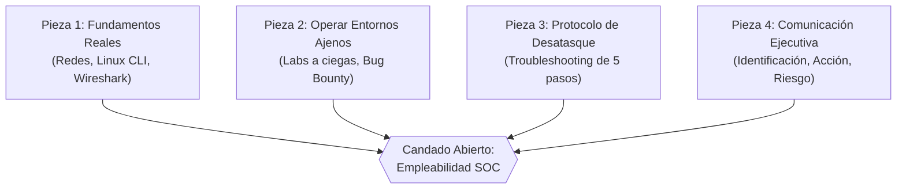
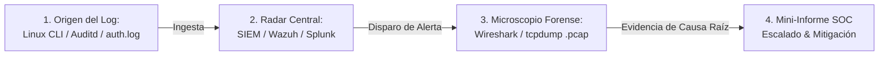
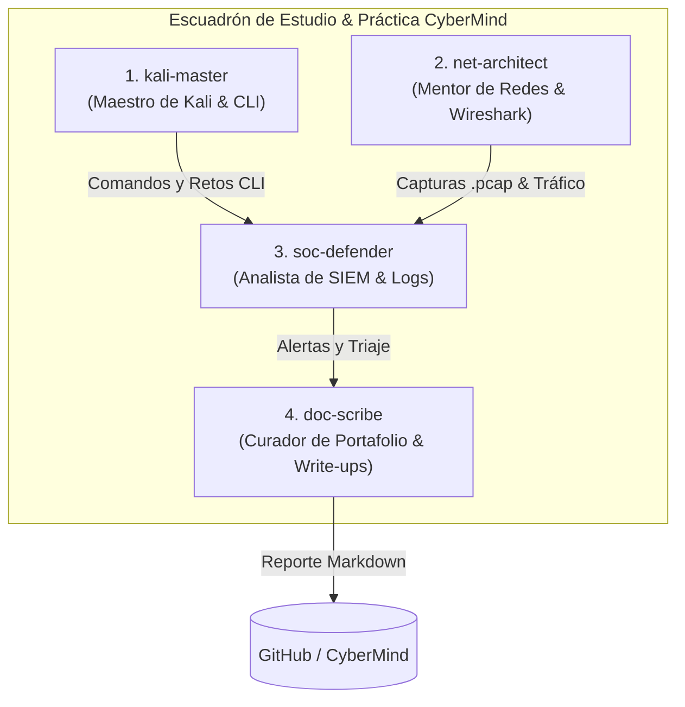

<!-- [Agent-Architect] 2026-11-09: Creación del blueprint integral de formación hacia SOC Analyst Tier 1. Integra las 4 piezas del candado de empleabilidad (RINKU), la triada defensiva (Linux CLI + Wireshark + SIEM) y el equipo de 4 agentes de estudio. -->

# 🛡️ SOC Analyst Blueprint: Linux CLI, Wireshark, SIEM & Triaje Defensivo

> **Propósito:** Documentar la arquitectura técnica y metodológica que conecta la terminal de Kali Linux, el análisis forense de paquetes en Wireshark y la correlación centralizada de eventos en un SIEM (Wazuh / Splunk), formando la base operativa de un **Analista SOC Tier 1 (Blue Team)**.

---

## 🔐 1. El Candado de la Empleabilidad (Framework de 4 Piezas)

Inspirado en la filosofía técnica de **Pablo López (RINKU)** (*«Paso firme, vista larga y mala leche»*), conseguir empleo internacional en ciberseguridad defensiva no depende de coleccionar certificados teóricos aislados, sino de abrir un candado de 4 números donde todas las piezas deben encajar:



### 1.1 Las 4 Piezas Obligatorias

| Pieza | Principio Técnico | Aplicación Práctica en CyberMind |
|---|---|---|
| **Pieza 1: Fundamentos Reales** | Comprender cómo viaja la información (TCP/IP, DNS, ARP), cómo funciona la web (HTTP/S, TLS) y cómo opera el sistema operativo (FHS, usuarios, procesos, servicios) sin atajos. | Desmontar cada alerta en su raíz: capturar el paquete con Wireshark y rastrear el evento en los logs del kernel/auth de Linux. |
| **Pieza 2: Operar Entornos Ajenos** | Salir del "tutorial guiado" donde todo funciona. Enfrentar máquinas y redes que no has configurado tú mismo. | Resolver retos de TryHackMe / Blue Team Labs sin write-ups previos; analizar topologías ajenas y responder incidentes en vivo. |
| **Pieza 3: Protocolo de Desatasque** | Enfrentar bloqueos técnicos con método riguroso antes de recurrir a ayuda externa. | Aplicar el protocolo de 5 pasos: leer error completo → aislar variable → consultar documentación oficial entre comillas → límite de tiempo → documentar la solución. |
| **Pieza 4: Comunicación Ejecutiva** | Traducir hallazgos técnicos complejos al lenguaje de impacto de negocio (riesgo financiero, reputacional u operativo). | Cerrar cada laboratorio con un mini-informe ejecutivo de 1 página: **Identificación**, **Acción** y **Riesgo/Mitigación**. |

---

## 🔬 2. La Triada Defensiva: Del Log Local al Microscopio de Red

En el día a día de un Centro de Operaciones de Seguridad (SOC), la detección y el triaje (*triage*) de incidentes opera en tres niveles complementarios:



### 2.1 El Origen: Linux CLI & Telemetría Local (`/var/log/`)
Todo incidente nace en el endpoint o servidor. Antes de que exista un dashboard bonito, existe una línea en un archivo de texto en el sistema de archivos de Linux:
- `/var/log/auth.log` (Debian/Kali/Ubuntu) o `/var/log/secure` (RHEL/CentOS): Intentos de autenticación SSH, escalada con `sudo`, creación de sesiones y accesos fallidos.
- `/var/log/syslog` o `journalctl -xeu`: Comportamiento de daemons y servicios críticos (`ssh`, `apache2`, `nginx`).
- **Práctica en Kali:** Monitoreo activo en vivo con `sudo tail -fn0 /var/log/auth.log` mientras se simula un ataque de fuerza bruta o elevación de privilegios no autorizada.

### 2.2 El Radar Central: El SIEM (Wazuh / Splunk / Elastic)
El SIEM recolecta y correlaciona millones de eventos por segundo provenientes de múltiples servidores Linux, controladores de dominio Windows (Active Directory), firewalls y routers:
- **Regla de Correlación Ejemplo:** *«Si la IP `192.168.1.150` genera > 10 fallos de autenticación en SSH en menos de 60 segundos y随后 genera 1 sesión abierta (Accepted password/publickey), disparar Alerta Nivel 10: Successful Brute Force Authentication»*.
- **Misión del Analista Nivel 1:** Clasificar la alerta, verificar si se trata de un falso positivo (ej. script de mantenimiento interno) o un compromiso real de credenciales, y determinar el alcance (*scope*).

### 2.3 El Microscopio Forense: Wireshark & `tcpdump` (`.pcap`)
El SIEM te dice **qué** alarma sonó y **cuándo**. Wireshark te permite abrir la captura de tráfico crudo del incidente para inspeccionar los bytes exactos:
- **Análisis de Capa 3 y 4:** Verificación del *Three-Way Handshake* (`tcp.flags.syn == 1`), detección de escaneos de puertos (`SYN Stealth Scan` con `nmap -sS`), o secuestros de sesión.
- **Análisis de Capa 7:** Reconstrucción de flujos HTTP/DNS mediante `Follow -> TCP Stream`. Identificación de dominios de Comando y Control (C2) mediante consultas DNS sospechosas (ej. subdominios generados por DGA o transferencias masivas de datos vía DNS tunneling).

---

## 🤖 3. Arquitectura del Equipo de Agentes de Estudio (Laboratorio)

Para mantener un ritmo de estudio de alto rendimiento sin saturación, el laboratorio de **CyberMind** se apoya en un escuadrón de 4 agentes especializados:



### Perfiles del Equipo:

1. **`kali-master` (Maestro de Kali Linux & CLI):**
   - **Enfoque:** Guía técnica terminal-first bajo el método *«Explicación Breve (máx 4 líneas) -> Ejemplo Real -> Prueba Práctica»*.
   - **Programa:** 6 niveles progresivos (Supervivencia CLI, Permisos/sudo, Tuberías/Grep, Procesos/Logs, Redes/Kali y Bash Scripting).
   - **Regla de Oro:** Principio de menor privilegio y comprensión estricta de banderas antes de ejecutar cualquier comando.

2. **`net-architect` (Mentor de Redes & Protocolos):**
   - **Enfoque:** Explica la anatomía de paquetes subyacente. ¿Qué pasa en el cable cuando ejecutas `curl`, `ssh` o `ping`?
   - **Herramientas:** Wireshark, `tcpdump`, filtros de visualización BPF/display, análisis de Three-Way Handshake, TCP Stream reconstruction.

3. **`soc-defender` (Analista de Defensa, SIEM & Logs):**
   - **Enfoque:** La perspectiva del Blue Team. ¿Cómo se ve la actividad en `/var/log/auth.log`, `journalctl`, Sysmon y reglas de Wazuh?
   - **Herramientas:** Wazuh, Splunk Free, Sigma rules, MITRE ATT&CK mapping y clasificación de severidad (Triage L1).

4. **`doc-scribe` (Curador de Portafolio & Documentación):**
   - **Enfoque:** Transforma la salida cruda de la terminal y los archivos `.pcap` en reportes técnicos estandarizados y mini-informes ejecutivos listos para GitHub y redes profesionales.

---

## 📋 4. Plantilla de Mini-Informe Ejecutivo SOC (Pieza 4)

Cada incidente o laboratorio defensivo debe poder explicarse a directivos y clientes no técnicos mediante esta estructura de 3 puntos:

```markdown
### 📝 Mini-Informe Ejecutivo de Incidente / Laboratorio

* **Fecha / Analista:** [AAAA-MM-DD] | Analista Junior SOC: [Tu Nombre]
* **Objetivo Evaluado:** [Nombre del laboratorio o incidente simulado]
* **Severidad:** [Informativa | Baja | Media | Alta | Crítica]

---

1. **Identificación (¿Qué fallo o incidente se detectó?):**
   Explicación concisa en 2 o 3 líneas del evento sin jerga excesiva. Ejemplo:
   > Se detectaron 65 intentos de inicio de sesión fallidos dirigidos a la cuenta administrativa en el servidor Linux en un intervalo de 2 minutos, seguidos de un acceso exitoso desde una dirección IP no reconocida en la red local.

2. **Acción (¿Cómo ocurrió técnicamente y qué evidencia existe?):**
   Evidencia técnica verificable:
   * **Registro del Sistema:** Líneas de `/var/log/auth.log` con evento `Failed password` seguidas de `Accepted password for kali from 192.168.1.150 port 49210 ssh2`.
   * **Análisis de Red (Wireshark):** Flujo TCP en puerto 22 evidenciando ráfaga constante de paquetes `SYN` y negociación de cifrado SSH repetida.
   * **Mapeo MITRE ATT&CK:** [T1110.001 - Brute Force: Password Guessing](https://attack.mitre.org/techniques/T1110/001/).

3. **Riesgo y Mitigación (¿Cuál es el impacto para el negocio y cómo se corrige?):**
   * **Impacto en el Negocio:** Posible acceso no autorizado a datos confidenciales del servidor y riesgo de escalada de privilegios o movimiento lateral.
   * **Mitigación Inmediata (Hotfix):** Bloqueo preventivo de la IP en el firewall (`sudo iptables -A INPUT -s 192.168.1.150 -j DROP`).
   * **Mitigación Definitiva (Hardening):**
     1. Deshabilitar inicio de sesión por contraseña en SSH en favor de autenticación obligatoria por llave pública (`PubkeyAuthentication yes`, `PasswordAuthentication no` en `/etc/ssh/sshd_config`).
     2. Desplegar `fail2ban` para bloqueo automático de IPs tras 5 intentos fallidos consecutivos.
     3. Monitoreo y alerta en tiempo real en Wazuh.
```

---

## 🚀 5. Roadmap Práctico de 30 Retos (Linux CLI & SOC Tracker)

| # | Módulo | Reto Técnico | Comando / Herramienta Clave | Estado |
|---|---|---|---|---|
| **01** | Nivel 1: CLI Survival | Reconocimiento de Identidad, Entorno y Kernel | `whoami`, `id`, `uname -srm`, `ip -br a`, `tee` | 🟡 En progreso |
| **02** | Nivel 1: CLI Survival | Exploración del FHS y archivos críticos del sistema | `ls -la /etc/passwd`, `/var/log`, `/proc/cpuinfo` | ⚪ Planificado |
| **03** | Nivel 1: CLI Survival | Manipulación segura de archivos y directorios aislados | `mkdir`, `touch`, `cp -p`, `mv`, `rm -i` | ⚪ Planificado |
| **04** | Nivel 2: Permisos | Permisos octales vs simbólicos y umask | `chmod 750`, `chmod u=rwx,g=rx`, `umask` | ⚪ Planificado |
| **05** | Nivel 2: Permisos | Gestión de propietarios, grupos y sticky bit en `/tmp` | `chown`, `chgrp`, `chmod +t` | ⚪ Planificado |
| **06** | Nivel 2: Permisos | Auditoría de privilegios `sudo` y principio de menor privilegio | `sudo -l`, `/etc/sudoers.d/`, `visudo` | ⚪ Planificado |
| **07** | Nivel 3: Pipes & Grep | Extracción de cuentas reales y shells interactivas | `grep -v "nologin" /etc/passwd \| cut -d: -f1,7` | ⚪ Planificado |
| **08** | Nivel 3: Pipes & Grep | Filtrado forense de accesos fallidos en logs de autenticación | `grep "Failed password" /var/log/auth.log \| awk '{print $11}' \| sort \| uniq -c` | ⚪ Planificado |
| **09** | Nivel 3: Pipes & Grep | Búsqueda forense de binarios SUID y archivos modificados | `find / -perm -4000 -type f 2>/dev/null` | ⚪ Planificado |
| **10** | Nivel 3: Pipes & Grep | Redirecciones avanzadas (`stdout`, `stderr`, `/dev/null`) | `2>&1`, `&>`, `/dev/null` | ⚪ Planificado |
| **11** | Nivel 4: Procesos | Auditoría de procesos en ejecución y consumo de recursos | `ps aux --sort=-%mem`, `top`, `htop` | ⚪ Planificado |
| **12** | Nivel 4: Procesos | Detección de procesos huérfanos o sospechosos y señales | `pgrep`, `kill -15`, `kill -9`, `pkill` | ⚪ Planificado |
| **13** | Nivel 4: Servicios | Gestión de servicios críticos y arranque del sistema | `systemctl status`, `systemctl is-active`, `journalctl -u` | ⚪ Planificado |
| **14** | Nivel 4: Servicios | Auditoría de tareas programadas del sistema (Cron persistence) | `crontab -l`, `/etc/cron.*`, `systemd-timers` | ⚪ Planificado |
| **15** | Nivel 5: Redes CLI | Inspección de sockets abiertos e interfaces activas | `ip a`, `ss -tuln`, `netstat -tulnp` | ⚪ Planificado |
| **16** | Nivel 5: Redes CLI | Comprobación de conectividad y resolución DNS en consola | `ping -c 4`, `dig +short`, `nslookup`, `traceroute` | ⚪ Planificado |
| **17** | Nivel 5: Redes CLI | Peticiones HTTP manuales y auditoría de cabeceras de respuesta | `curl -Iv`, `curl -s -D - -o /dev/null` | ⚪ Planificado |
| **18** | Nivel 5: Kali Recon | Escaneo de puertos local no intrusivo y detección de banners | `nmap -sT -p- -sV localhost`, `nc -zv` | ⚪ Planificado |
| **19** | Nivel 5: Kali Recon | Sniffing de tráfico en consola con `tcpdump` | `sudo tcpdump -i any -nn -c 10 icmp` | ⚪ Planificado |
| **20** | Nivel 6: Bash Scripts | Script de chequeo de integridad y auditoría de sistema | Script de inventario (CPU, RAM, disco, users, puertos) | ⚪ Planificado |
| **21** | Nivel 6: Bash Scripts | Monitor automático de fuerza bruta en tiempo real | Script parser de `/var/log/auth.log` con alertas en consola | ⚪ Planificado |
| **22** | Wireshark Lab 1 | Captura de Three-Way Handshake TCP e inspección de flags | Filtro `tcp.flags.syn == 1`, análisis SYN, SYN-ACK, ACK | ⚪ Planificado |
| **23** | Wireshark Lab 2 | Inspección de tráfico HTTP en texto plano y Follow Stream | Filtro `http`, extracción de formularios POST y credenciales | ⚪ Planificado |
| **24** | Wireshark Lab 3 | Detección de anomalías DNS y túneles de exfiltración | Filtro `dns`, conteo de queries por longitud de nombre | ⚪ Planificado |
| **25** | Wireshark Lab 4 | Análisis forense de escaneo SYN de Nmap en captura `.pcap` | Identificación de patrones de sondeo masivo en ráfagas | ⚪ Planificado |
| **26** | SIEM / Wazuh 1 | Despliegue de agente Wazuh en endpoint Kali Linux | Conexión del agente al Wazuh Manager y verificación | ⚪ Planificado |
| **27** | SIEM / Wazuh 2 | Simulación de acceso indebido y visualización en dashboard | Alerta de intento `sudo` fallido y correlación en Wazuh | ⚪ Planificado |
| **28** | SIEM / Wazuh 3 | Creación de regla personalizada para evento específico | Regla de detección para ejecución de comandos específicos | ⚪ Planificado |
| **29** | SOC Triage Lab | Simulación de incidente completo (Phishing / Port Scan) | Flujo L1: Alerta SIEM → Análisis .pcap → Aislamiento | ⚪ Planificado |
| **30** | Portfolio Capstone | Reporte Integral de Incidente con Formato STAR | Publicación de write-up profesional y evidencias en GitHub | ⚪ Planificado |

---

*CyberMind Security Operations — Paso firme, vista larga y evidencia irrebatible.*
